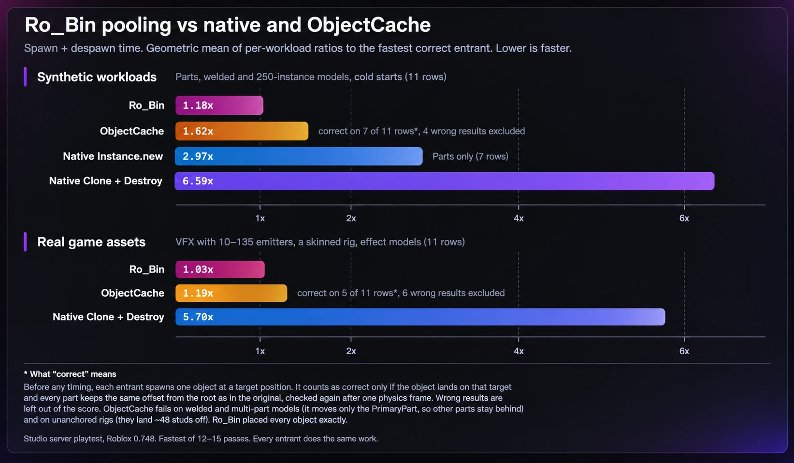
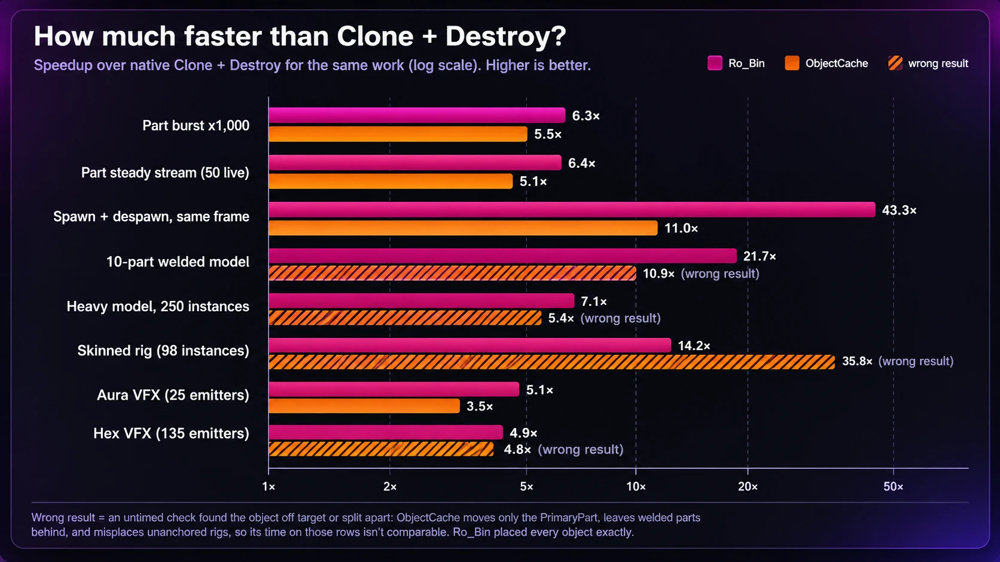
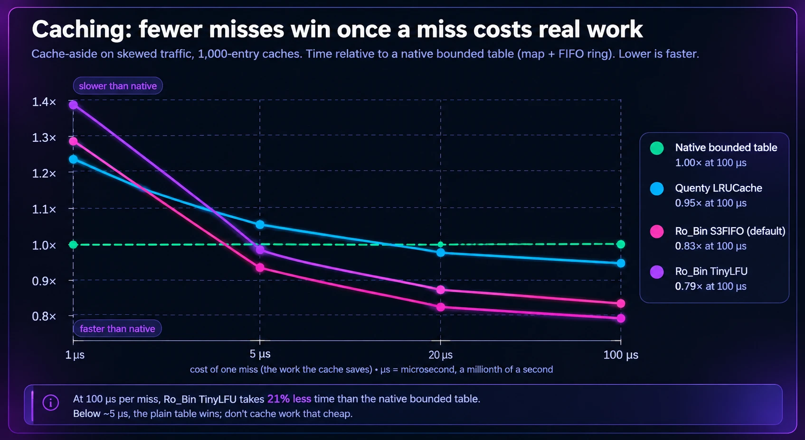

# Ro_Bin

**Ro_Bin is a resource management framework for Roblox**, written in strict Luau. It manages everything your game creates, reuses and throws away: Instances, tables, buffers, computed results, connections and threads.

It covers three jobs:
- **Pooling:** spawning and destroying Instances is one of the most expensive things a Roblox game does every frame (projectiles, hit effects, VFX bursts, debris, NPC rigs). Ro_Bin keeps those objects alive and reuses them, so you stop paying for `Clone()` and `Destroy()` on every spawn.
- **Caching:** it stores expensive work (pathfinding, raycasts, data lookups, generated values) and is smart about which entries to keep.
- **Lifetime:** it tracks who holds what. Leases catch leaks, pools grow and shrink with load, and a `Bin` cleans up connections, instances, threads and pool leases in one call.

All three report through one manager, so you can see every resource your game holds with `manager:Report()`.

> **v0.0.1, early preview.** The API works and is tested, but it may still change before 1.0. Feedback and issues are welcome.

---

## What's in the box

### Pooling
| Pool | Use it for |
|---|---|
| `InstancePool` | Parts, models, rigs and VFX. Parks unused objects off-screen, moves them back in batches with `BulkMoveTo`, and keeps every part's offset exact. |
| `Pool` | Any Luau value (tables, class objects, anything). You pass a `Factory` function that builds a new one when the pool runs out. |
| `TablePool` | Reusable scratch tables. |
| `BufferPool` | `buffer`s bucketed by size. |

Every pool supports:
- prewarming, optionally spread over frames
- a capacity cap, with an overflow policy of `Expand`, `Reject`, `Steal` or `Fallback`
- adaptive sizing that grows under load and trims when idle
- leases with leak tracking: who took an object, and how long ago
- `Reset`, `OnAcquire`, `OnRelease`, `Validate` and `Destroy` hooks, plus middleware
- batch calls: `AcquireMany`, `AcquireManyAt` and `ReleaseMany`

### Caching
| Cache | Use it for |
|---|---|
| `Cache` | Full-featured cache with TTL, sliding expiry, tags, `GetOrCompute` (concurrent calls for the same key share one compute) and eviction signals. |
| `LiteCache` | The smallest, fastest capped cache when you only need get/set. |
| `WeakCache` | Entries that disappear when the key or value is garbage-collected. |
| `Memoize` | Wraps a function so repeat calls with the same arguments return the cached result. |

The eviction policy is your choice:
- **`S3FIFO`** is the default.
- **`TinyLFU`** misses the least.
- **`Clock`** and **`Sieve`** are cheap approximations of LRU.
- **`LRU`**, **`LFU`**, **`FIFO`** and **`None`** are also available.

S3-FIFO and W-TinyLFU are recent research algorithms (SOSP '23 and the policy behind Java's Caffeine) that keep the hot keys and push one-time keys out fast.

### Utilities
`Signal`, `Bin` (cleanup of connections, instances, threads and pool leases in one call), `ThreadPool`, `Scheduler`, `Heap` and `Metrics`. `manager:Report()` prints a summary of every pool and cache.

---

## Quick start

```lua
local Ro_Bin = require(game.ReplicatedStorage.Ro_Bin)
local bin = Ro_Bin.default()

local bullets = bin:CreateInstancePool("Bullets", {
	Template = game.ServerStorage.Bullet,
	InitialCapacity = 200,
	MaxCapacity = 500,
	OverflowPolicy = "Fallback",
})

local bullet = bullets:AcquireAt(muzzle.CFrame, workspace)
task.delay(2, function()
	bullets:Release(bullet)
end)

local paths = bin:CreateCache("Paths", { MaxEntries = 500, TTL = 10 })
local path = paths:GetOrCompute(goalKey, function()
	return computePath(goalKey)
end)
```

---

## Benchmarks

All numbers come from the Ro_Bin Arena, run as a Studio server playtest. Each entrant does the same work, the order rotates every pass, and the fastest of 12–15 passes counts. Before any timing, every entrant has to place one object correctly; wrong results don't count.



- **Synthetic workloads:** Ro_Bin scores 1.18× against 1.62× for ObjectCache, 2.97× for `Instance.new` and 6.59× for `Clone()` + `Destroy()`. Lower is better.
- **Real game assets** (VFX with up to 135 emitters, a skinned rig): Ro_Bin scores 1.03× against 1.19× for ObjectCache and 5.70× for Clone + Destroy.



Against `Clone()` + `Destroy()`, Ro_Bin is **5–43× faster**. It also places welded models, multi-part models and unanchored rigs exactly, which ObjectCache does not.



When a cache miss costs real work, Ro_Bin's policies win because they miss less. At 100 µs per miss (µs is a microsecond, a millionth of a second), TinyLFU takes **21% less time** than a native bounded table.

### Where native still wins
We'd rather you hear it from us:
- **One-off spawns:** `Instance.new` beats any pool when an object is never reused. Pooling pays off from the second spawn.
- **Cold pools:** with nothing prewarmed, building on demand is slower. Prewarm your pools.
- **Cheap work:** for lookups that cost under ~5 µs to recompute, a plain table is faster. Don't cache work that cheap.

Timings cover Luau-side work only, not replication or rendering. Expect about ±10% run-to-run noise.

---

## Install
1. Download **`RO-BIN.rbxm`** from the latest release (or from this repo).
2. In Studio, right-click **ReplicatedStorage**, choose **Insert from File…** and pick the file.
3. `require(game.ReplicatedStorage.Ro_Bin)`

## Thanks
The benchmarks compare against **ObjectCache** by Pyseph and **LRUCache** by Quenty (both MIT). Thanks to their authors.
